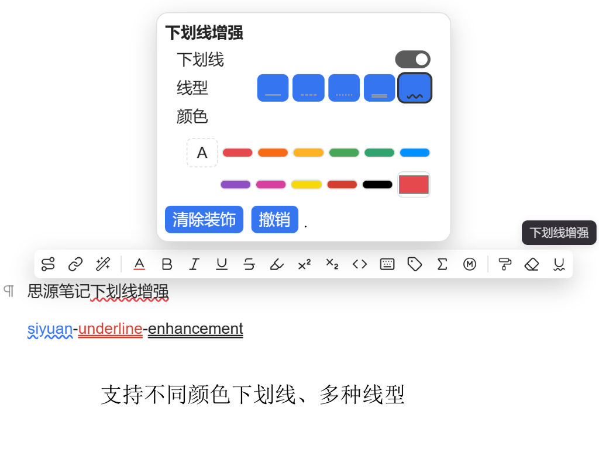

# Underline Enhancement

[简体中文](README.zh-CN.md)

Configure CSS `text-decoration` underlines and overlines — line style and color, set independently for each
direction — from the floating toolbar of the SiYuan Note editor.

* Package name: `siyuan-underline-enhancement`
* Requires SiYuan 3.8.6 or later (`minAppVersion: 3.8.6`)
* Works on desktop, in the desktop web app and in the mobile apps

## What it does

SiYuan's own floating toolbar offers one underline button and no way to change the line style or the color.
This plugin adds an **Underline Enhancement** button to the floating toolbar. Clicking it opens a small panel
where the underline and the overline are configured separately:

* **Switch** each direction on or off — underline and overline.
* **Line style**: `solid`, `dashed`, `dotted`, `double`, `wavy`. The swatches draw the real line with CSS
  `text-decoration-style` instead of an icon character.
* **Color**: follow the text color, pick one of 10 preset colors, or use the color input for a custom value.
  A custom value gets its own swatch in the row, so the color in use is always visible.
* **Clear decoration** removes both directions from the selection.
* **Undo** steps the decoration back one change — the change _you_ made, including every block it touched.
  It covers the current panel session only: the stack is dropped when the panel closes, so use the document
  history for anything older. An entry whose blocks you have edited since is skipped rather than
  overwriting your later edits.
* Every change previews live on the selection and is saved on a 300 ms debounce. The last configuration you
  used is remembered and becomes the panel's starting point the next time you select undecorated text.
* A direction's switch starts **on** for the underline and **off** for the overline. While a direction is
  off, its line-style row, colour row and colour input are disabled — turn the switch on first.
* If the regions in one selection do not all carry the same decoration, the panel says so before you click:
  one change then applies that single configuration to the whole selection.

Decorations are stored as inline styles on `<span>` elements. That is why they keep rendering when the plugin
is not loaded at all — in read-only mode, on a published page, or when the document is opened elsewhere.
When the underline and the overline differ, the two directions are written as two nested spans (outer span
carries the overline, inner span the underline); when both are identical they collapse into a single span
with `text-decoration-line: underline overline`.

### Screenshot

<!-- Screenshot placeholder: capture the panel opened from the floating toolbar and save the image as
     docs/images/screenshot.png, then uncomment the line below. -->

<!--  -->

_Screenshot placeholder: the Underline Enhancement panel, opened from the editor's floating toolbar, with the
underline section set to a wavy red line and the overline section set to a solid blue line._

## Installation

### From the marketplace

Once the plugin is published: **Settings → Marketplace → Installed**, search for _Underline Enhancement_, click
**Install**, then enable it.

### Manual installation

`{workspace}` is your workspace data folder; **Settings → About** shows its path. On a default installation it
is `~/SiYuan/data`.

1. Build the plugin (`npm run build`) or download a release archive.
2. Create the directory `{workspace}/data/plugins/siyuan-underline-enhancement/`.
3. Copy the built files into it, **flat** — no `dist/` level in between:

   ```text
   {workspace}/data/plugins/siyuan-underline-enhancement/
   ├── plugin.json
   ├── index.js
   ├── index.css
   ├── icon.png
   ├── preview.png
   └── i18n/
       ├── en.json
       └── zh-CN.json
   ```

4. Restart SiYuan, then enable the plugin under **Settings → Marketplace → Installed**.

A release archive (`package.zip`) holds those entries at its root — plus the two README files — so it can be
extracted straight into the plugin directory.

## Usage

1. Select text in the editor. The floating toolbar appears.
2. Click the **Underline Enhancement** icon in that toolbar. The icon is part of every editor's toolbar; when
   the selection holds nothing to decorate — inside a code block, for instance — clicking it opens nothing.
3. In the panel, set the **Underline** and the **Overline** section independently: switch, line style, color.
4. Click **Clear decoration** to remove both directions from the selection, or **Undo** to step back one change.
5. Click outside the panel or press `Esc` to close it. The panel saves on close.

The selection may span paragraphs, list items and table cells; each editable region is wrapped on its own.
Every affected block is saved separately, so a multi-block change does not depend on a single write. One
exception to list items: a _tight_ list whose item text is a direct child of the `<li>` (no paragraph
inside the item) yields no editable region, so that text cannot be decorated. See
[docs/manual-verification.md](docs/manual-verification.md) item 6.

## Known limitations

1. **Exporting degrades the decoration.** Exporting to Markdown, HTML or PDF collapses the underline to a
   plain `<u>` tag and loses the overline, the line style and the color. Reason: SiYuan's Markdown engine
   (Lute) preserves only four inline styles — `color`, `background-color`, `font-family` and `font-size`.
   This is SiYuan's export-pipeline behaviour, not a defect of this plugin.
2. **Ctrl+Z does not undo this plugin's operations.** The decoration is written through
   `/api/block/updateBlock`, which produces no transaction, so SiYuan's undo stack never sees it. Use the
   panel's **Undo** button or SiYuan's document history to recover.
3. **Code blocks are not supported.** This matches SiYuan's own floating toolbar, which does not show up for
   code blocks either.
4. **Changes are scoped to the selected range, not to the whole block.** Applying, restyling and
   **Clear decoration** only touch decoration inside the selection; decoration elsewhere in the same block
   is preserved. To restyle or clear decoration outside the selection, select it first.
5. **Undo covers one recorded change, and only within the current panel session.** All blocks touched by one
   change are reverted by a single press; an entry is skipped when any of its blocks no longer matches what
   the change left behind (because you have edited it since). The stack is emptied when the panel closes,
   so a change is only undoable while the panel that made it is still open.

Read-only mode and published pages are not limitations: the plugin does not register its toolbar button
there, but decorations keep rendering because they are plain inline styles.

## Development

```bash
npm install       # install dependencies (Node.js >= 24)
npm run dev       # watch build, writes ./index.js and ./index.css
npm test          # run the unit tests (node:test)
npm run build     # production build, writes ./dist/ and ./package.zip
```

Type check:

```bash
node node_modules/typescript/bin/tsc --noEmit
```

Lint and format:

```bash
npm run lint          # ESLint, fixes what it can
npm run format        # dprint
npm run format:check  # dprint, report only
```

Acceptance on a real SiYuan instance — the parts the unit tests cannot reach (rendering, export, publish,
read-only, mobile, undo after a re-render, stacking order) — has its own checklist, in English and Chinese:
[docs/manual-verification.md](docs/manual-verification.md).

The production build is what ships: `dist/` holds the loadable plugin, and `package.zip` holds the same files
with the `dist/` prefix stripped, ready to extract into a plugin directory.

## License

Released under the MIT License. The full text is in [LICENSE](LICENSE).
